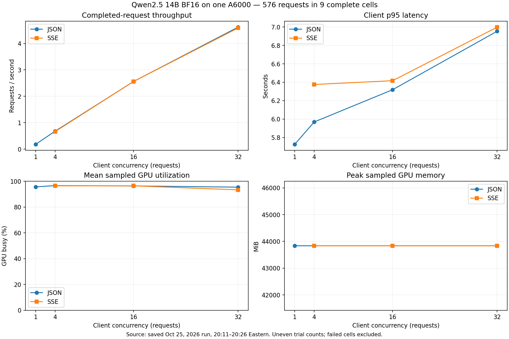

# Qwen2.5 14B on one A6000

Analyzed October 28, 2026. Run recorded October 25, approximately 20:11–20:26
America/New_York. This is a partial baseline: **576 successful measured requests
in nine complete cells**, followed by seven interrupted cells. No new experiment
was run for this analysis.

## Main finding

The saved timing counters show a **decode-dominated workload**, with sampled GPU
busy time around 93–97%, low engine queue time, and ample remaining allocated KV
cache. This is evidence that generating tokens is the dominant measured cost.
It does not distinguish GPU memory bandwidth from arithmetic throughput, or prove
that either resource is saturated.

Increasing JSON concurrency from 16 to 32 raised throughput from **2.56 to 4.62
requests/s (+80%)**, while pooled client p95 increased from **6.32 to 6.95 seconds
(+10%)**. At the fixed 128 output tokens/request, that is approximately **328 to
591 output tokens/s**. This range is still benefiting strongly from batching;
these measurements do not establish a throughput plateau or a need for a second
worker at a specified service target.



## What was measured

The unchanged baseline uses seed 42, summarization with 128 context words plus
the instruction, a 128-token output cap, and concurrency 1/4/16/32. Each cell has
64 measured requests and two warmups. JSON and SSE are separate response modes.
All 576 successful measured responses reached 128 output tokens.

The model was downloaded as Qwen/Qwen2.5-14B-Instruct and served as
`tokenflow-model`, root `/models/qwen14b`, with vLLM 0.10.2. The launch command used
BF16, max model length 2048, GPU memory utilization 0.9, prefix caching, and one
A6000. The downloaded revision was not captured. `environment.json` records the
server-reported model root and engine version; the setup guide records flags.

The completed cells cover JSON concurrency 1, 4, 16, 32 and SSE concurrency 4, 16,
32. JSON-16 and SSE-4 each have two completed trials; all other completed groups
have one. There is no completed SSE concurrency-1 cell. Group throughput is total
successful requests divided by summed measured trial durations. Group p95 is
computed from pooled raw request durations, not an average of trial p95 values.

## Where latency went

Exact cumulative histogram deltas isolate 64 measured completions per successful
cell, excluding warmups. All nine cells have validated phase boundaries and no
counter resets were detected. These are **means**, not a decomposition of p95.

- JSON concurrency 1: mean engine decode **5.531 s**, prefill **44.5 ms**, queue
  **0.057 ms**. Client mean **5.653 s**; engine end-to-end mean **5.577 s**.
- JSON concurrency 16, pooled across two trials: decode **5.997 s**, prefill
  **53.1 ms**, queue approximately **0.010 ms**. Client mean approximately
  **6.218 s**.
- JSON concurrency 32: decode **6.532 s**, prefill **57.1 ms**, queue **0.012 ms**.
  Client mean **6.844 s**; engine end-to-end mean **6.616 s**.

For JSON 16→32, client mean latency grew about **0.626 s**. Decode grew about
**0.535 s**, explaining roughly **85%** of that increase. The client-minus-engine
residual grew about **0.085 s**. That residual combines gateway, network, tunnel,
serialization and timing-boundary differences; it cannot be assigned to one of
them with the saved data. Prefill and other engine time explain the remainder.

The direct engine inter-token histogram averages about **47.1 ms at JSON-16**
and **51.2 ms at JSON-32**. These particular deltas include the two warmups per
cell: each contains 8,382 observations, matching 66 × 127 token gaps. Engine ITL
is distinct from client SSE chunk-arrival timing.

The first streaming concurrency-4 trial had a higher mean prefill (**220 ms**)
than the later concurrency-4 trial (**46 ms**). It also had lower mean sampled
power. Treat it as observed trial variation, not proof of a cache or warmup cause.

## What hardware and engine telemetry add

The hardware file contains **6,340 samples**, spanning 19:33:12–20:26:04 Eastern,
with no reported GPU collection errors. Every successful cell has coverage;
concurrency-32 cells have only 27–28 hardware samples each. Sample frequency is
approximately 0.5 seconds, so very short transients may be missed.

- **GPU busy time:** about 95.7% at JSON-1, 96.6% at JSON-4, 96.4% at JSON-16,
  and 95.4% at JSON-32. High busy time at concurrency 1 did not prevent substantial
  throughput improvement with batching. Utilization reports activity over an
  interval; it does not measure efficiency, achieved FLOPS, or bandwidth directly.
- **GPU memory:** sampled usage stayed at **43,836 MiB (42.81 GiB)** during all
  completed cells. This includes preallocated cache and runtime memory; it is not
  the amount of live request state. A constant reservation does not establish
  that GPU memory capacity limited these tests.
- **KV cache:** peak sampled allocated-pool occupancy was about **0.71% at
  JSON-1**, **2.76% at JSON-4**, **11.00% at JSON-16**, and **21.46% at JSON-32**.
  SSE-32 reached **21.72%**. The saved gauges do not show cache exhaustion.
- **Waiting requests:** sampled maximum was **zero** in all successful cells;
  exact engine queue means were also tiny. Zero waiting does not mean no batching:
  requests can be admitted together and spend their time decoding as running
  requests. Brief queues between samples remain possible.
- **Power:** most cells averaged approximately **295–298 W**, close to the
  300 W limit previously reported by nvidia-smi. This supports substantial GPU
  activity; without clocks and throttle-reason metrics it does not prove power
  throttling.
- **CPU/RAM/disk:** measurements are node-wide because the monitor had no inference
  PID. Mean node CPU was roughly **14–15%**. This cannot rule out a busy gateway,
  saturated allocated CPU core, or other node workloads. Disk rates and free space
  are retained in the joined summary; no disk-bottleneck conclusion is justified
  without process/device attribution and latency or I/O-wait evidence.

## Comparison with the saved 0.5B baseline

Each 14B completed cell is matched to the 0.5B cell with the same response mode,
concurrency and trial index. Both use the same baseline definition. These are
separate runs on different dates; model size is not the only possible source of
variation, and 0.5B has no physical GPU monitor file.

- At JSON concurrency 1, throughput is about **10.4× lower** and p95 latency
  **9.8× higher** than the matched 0.5B trial.
- At JSON concurrency 16, throughput is **8.3–9.0× lower** and p95 latency
  **7.3–8.0× higher** across matched trials.
- At JSON concurrency 32, throughput is about **6.2× lower** and p95 latency
  **5.4× higher** than the matched 0.5B trial.

The larger model is substantially more expensive to serve, but larger batches
recover some aggregate efficiency. This is a serving-performance comparison;
answer quality was not evaluated, and parameter count alone does not predict
these speed ratios.

## Interruption and limits

At about **20:26:04 Eastern**, the first streaming request in the tenth cell lost
its stream. The hardware monitor's final timestamp is 20:26:04.911. Subsequent
vLLM scrapes failed and the gateway later returned 503 for an unreachable worker.
The registry still contained one worker; this is not evidence of registry loss.
The shared timing is consistent with cluster job/process termination, but job
accounting and shutdown logs are missing. The root cause remains unconfirmed.

Seven failed cells remain in `serving/summary.csv` and raw files for diagnosis.
They are excluded from `completed-cells.csv`, `analysis.json`, and the performance
chart. Their failure rate must not be interpreted as steady-state model capacity.

For the current learning goal, these nine cells support a useful preliminary
comparison. They cannot establish confidence intervals from repeated trials,
the optimal concurrency above 32, long-context capacity, or a scaling policy.
Future work should first recover job accounting, then vary input length, output
length, and concurrency independently while recording clocks/bandwidth or
profiling evidence if needed. No such experiments were run here.

## Files and reproduction

- `analysis.json`: detailed per-cell hardware statistics, matched 0.5B comparisons,
  exact phase means and methodology.
- `completed-cells.csv`: compact successful-cell measurements.
- `serving/summary.csv`: full timestamp-joined summary, including failed cells.
- `performance-and-gpu.png` and `.svg`: shareable plots of completed cells.
- `model-comparison.png` and `.svg`: JSON comparison using matched trials.
- `analysis.canvas.tsx`: self-contained visual review saved with the experiment.
- `analyze_results.py`: offline regeneration script; requires matplotlib for plots.
- Original JSONL telemetry, request files, environment and gateway logs are retained.
- `SHA256SUMS.csv`: evidence and derived-output checksums when the script ran.

From the repository root, regenerate the analysis without contacting the cluster:

```powershell
python results/qwen2.5-14B-single-gpu/analyze_results.py
```

Raw timing distributions and phase boundary counts are preserved in the outputs.
Hardware means are arithmetic sample means; they are not time-weighted integrals.
